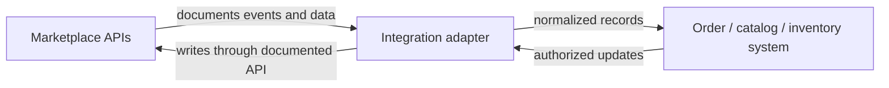

# [Marketplace] API catalog

This page inventories the official API groups in the scope of this integration. It is not necessarily the provider's entire API portfolio. Distinguish **API group count** from **operation count**: one API group commonly contains many operations. Count only against the provider's official catalog or versioned machine-readable specification, record the source and date, and write `not inventoried` rather than estimating.

## Inventory summary

| Measure | Count | Counting scope and source | Checked |
|---|---:|---|---|
| Provider API groups in the provider's full catalog | [number / not inventoried] | [official catalog URL and what is included/excluded] | YYYY-MM-DD |
| API groups relevant to this integration | [number] | [scoped groups listed below] | YYYY-MM-DD |
| Operations in the scoped official specifications | [number / not inventoried] | [spec files/versions and counting method] | YYYY-MM-DD |
| Operations this integration uses | [number / not inventoried] | [linked workflow operation tables] | YYYY-MM-DD |

Do not treat endpoints, HTTP methods, API groups, resources, webhook event types, or versions as interchangeable when counting. Explain how deprecated and regional duplicates were handled. If the provider does not publish a complete machine-readable inventory, say so and label the count as partial.

## API groups in scope

| API group | Version / region | Purpose | Relevant capabilities | Provider operation count | Operations used here | Timing / rate-limit source | Detailed page |
|---|---|---|---|---:|---|---|---|
| [Name] | [version / regions] | [business purpose] | [read, create, update, events, etc.] | [count or not inventoried] | [count/list or TBD] | [official link, date; unknown if undocumented] | [api-name.md] |

## Cross-API interaction map

Describe which API group supplies data another group requires, which group emits events, and which one performs the write. Include the integration's internal systems and direction of data movement. Separate provider-defined dependencies from recommended architecture. Use `TBD` where a flow has not been confirmed.

## Workflow entry points

| Workflow | Trigger / schedule | API groups and operations | Source of timing/limits | Guide |
|---|---|---|---|---|
| [Order discovery] | [event / polling / user action; documented cadence or TBD] | [group.operation names] | [source and checked date] | [workflow page] |

Keep detailed preconditions, call ordering, data mapping, errors, and recovery in the workflow documents. Never turn an example polling interval into a provider guarantee.

## Update checklist

- [ ] Inventory reflects the chosen region, API version, account program, and use case.
- [ ] Provider API-group and operation counts cite the official inventory/spec and define the counting method.
- [ ] Used operations link to the relevant official operation references and workflow pages.
- [ ] Deprecated operations are labeled and replacement/migration sources are linked.
- [ ] Timing, quota, payload, and batch limits are source-linked; unknown values remain explicitly unknown.
- [ ] Cross-API connections distinguish provider requirements from this integration's design.
- [ ] Last-checked dates are updated when official sources change.
