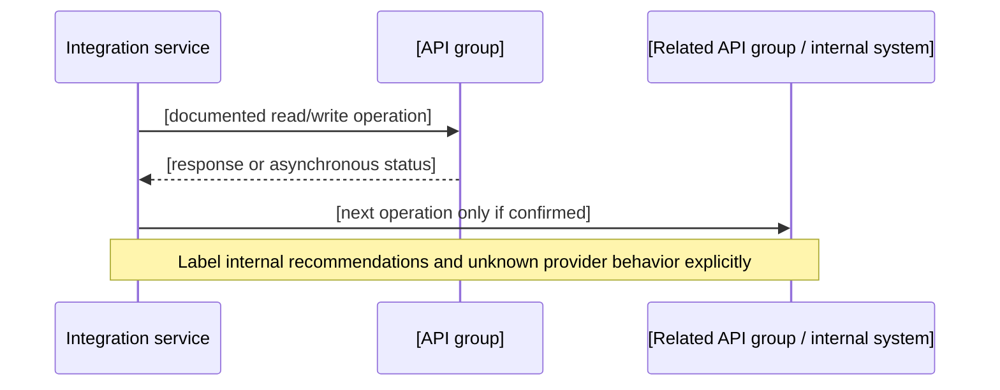

# [API group name] ([version])

| Field | Value |
|---|---|
| Purpose | [business capability this API provides] |
| Base host / region | [official source; do not assume regions share hosts] |
| Version / lifecycle | [current, deprecated, removal date, or unknown] |
| Access / roles | [account prerequisites, authorization scopes/roles, source] |
| Evidence status | [Official / Tested / Unverified] |
| Last checked | YYYY-MM-DD |

This is an original summary, not a copy of the provider's reference. Do not publish restricted docs, credentials, customer data, or payloads copied without redistribution permission.

## Purpose and capabilities

Explain what this API group is designed to do, which business entities it reads or changes, and what it does **not** do. State account types, regions, prerequisites, and known capability gaps. Link official provider documentation for each material statement.

| Capability | Supported / conditional / unknown | Operations | Conditions and evidence |
|---|---|---|---|
| [Capability] | [state] | [operation IDs] | [account, role, state, region, source] |

## Operation inventory and counts

Count operations from the official API reference or versioned machine-readable model. Define whether the count includes deprecated, administrative, notification, or regional variants. Do not estimate undocumented totals.

| Measure | Count | Source / method | Checked |
|---|---:|---|---|
| Operations published for this API version | [number / not inventoried] | [official reference/model and counting rule] | YYYY-MM-DD |
| Operations used by this integration | [number] | [operation IDs in workflows below] | YYYY-MM-DD |

| Operation ID / method | Purpose | Direction | Conditions / required fields | Workflow | Limits / pagination |
|---|---|---|---|---|---|
| [operation] | [purpose] | inbound / outbound / both | [roles, state, required identifiers] | [link] | [official source, unknown if not documented] |

List relevant operations, not every operation in the provider's catalog. Link the complete official reference instead of reproducing it.

## How this API connects to other API groups

Describe upstream data sources, downstream consumers, identifiers shared across API groups, and ownership of state. Mark provider-mandated sequencing separately from this playbook's recommended architecture.



## Workflow and timing

For each use case, show trigger, prerequisites, ordered calls, state transitions, expected completion signal, and recovery. Include actual provider-documented deadlines or rate/processing windows only when sourced. Separate those from the application's suggested scheduling cadence.

| Phase | Trigger / timing | Operation | Preconditions | Success condition | Failure / recovery |
|---|---|---|---|---|---|
| [discover/read/write/confirm] | [event, user action, provider deadline, or TBD] | [operation] | [roles, object state, required prior step] | [response/status] | [retry/reconcile/manual action] |

## Limits, pagination, and errors

| Constraint | Provider-documented value | Scope (operation/account/region) | Response signal | Handling | Official source / checked |
|---|---|---|---|---|---|
| Rate / burst limit | [value, dynamic, or unknown] | [scope] | [headers/status] | [backoff, queue, rediscover quota] | [URL, date] |
| Page / cursor limit | [value or unknown] | [scope] | [cursor/token] | [resume/dedupe] | [URL, date] |
| Payload / batch limit | [value or unknown] | [scope] | [validation/partial result] | [chunk/repair] | [URL, date] |
| Processing deadline | [value or unknown] | [scope] | [status/event] | [poll/event/reconcile] | [URL, date] |

Cover retryable vs permanent errors, throttling, authentication expiry, partial success, idempotency, request timeout, cursor expiry, duplicate events, and out-of-order updates. Never invent a limit. If quotas vary dynamically, document how to discover them at runtime.

## Sanitized payload examples

Use small, synthetic examples that illustrate the request/response shape and only fields relevant to the workflow. Cite the official operation schema. Preserve exact official field names only as needed; do not copy large schemas or real seller/customer records. Mark omitted required fields and provider-specific signing/authentication setup clearly.

### Request / response shape

```json
{
  "example": "replace with minimal synthetic fields from the official schema",
  "note": "Not a complete request; consult the linked official operation reference."
}
```

### Python walkthrough

Use the provider's supported SDK or documented HTTP/signing mechanism. Keep authorization and signing behind an explicitly named secure client abstraction; this snippet intentionally does not implement credentials, request signing, pagination, or retries.

```python
async def read_resource(client, resource_id: str):
    """Illustrative orchestration only; client implements provider auth/signing."""
    response = await client.get_resource(resource_id=resource_id)
    response.raise_for_status()
    return response.json()
```

### NestJS walkthrough

Use a provider-supported SDK or an injected, configured API client. Keep tokens and signing outside the example; this is a service-shape illustration, not production-ready authentication code.

```typescript
@Injectable()
export class MarketplaceApiService {
  constructor(private readonly apiClient: MarketplaceApiClient) {}

  async readResource(resourceId: string): Promise<unknown> {
    return this.apiClient.getResource({ resourceId });
  }
}
```

For both languages, explain the needed SDK/client, configuration boundaries, validation, timeouts, throttling, retries, idempotency, and how tests use synthetic fixtures. Never show hard-coded credentials or suggest that a generic code fragment can replace provider-required signing.

## Test cases and verification

| Case | Expected result | Test source (sandbox/mock/authorized account) | Result / date |
|---|---|---|---|
| Valid minimal request | [expected] | [environment] | [not run / result] |
| Missing permission / invalid state | [expected] | [environment] | [not run / result] |
| Throttling / transient failure | [expected] | [environment] | [not run / result] |
| Pagination / duplicate / partial result | [expected] | [environment] | [not run / result] |

Distinguish schema validation, mocks, provider sandbox behavior, and production observations. A schema check is not a live API contract test.

## Official references

- API overview: [URL, version, date checked]
- Operation reference / machine-readable model: [URL, version, date checked]
- Authentication / roles: [URL, date checked]
- Quotas, pagination, and errors: [URL, date checked]
- Changelog / deprecation: [URL, date checked]
