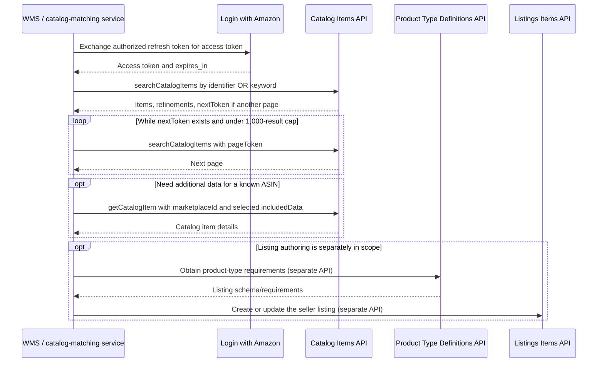

# Amazon Catalog Items API (v2022-04-01)

| Field | Value |
|---|---|
| Purpose | Read/search product data in Amazon's shared catalog; this API does not create or update seller listings. |
| Current version | `2022-04-01`; Amazon also lists legacy versions `v0` and `2020-12-01`. Use the current version for new work. |
| API groups in this dossier | 1 |
| Operations in the official v2022-04-01 model | 2: `searchCatalogItems`, `getCatalogItem` |
| Roles | Product Listing role for either operation; Amazon lists NA, EU, and FE availability. |
| Evidence | Official documentation and model reviewed 2026-11-05; code examples are illustrative and have not been tested against a live seller account. |

This is a public, independent engineering summary. Do not add live credentials, seller/customer data, copied restricted material, or large portions of Amazon's model. Link to Amazon's live sources when implementing. The official [Catalog Items guide](https://developer-docs.amazon/sp-api/docs/catalog-items-api) identifies `2022-04-01` as current and lists item summaries, attributes, browse classifications, dimensions, product identifiers, images, sales rankings, relationships, and identifier/keyword search as use cases. Vendors can receive vendor-specific details.

## API purpose and boundaries

Catalog Items is a **read-only catalog lookup**. It helps resolve an ASIN or find catalog items by identifiers or keywords, then retrieve selected catalog datasets. It is not the seller's offer/listing state, inventory-write interface, product creation API, or order API. Use [Listings Items](https://developer-docs.amazon/sp-api/docs/listings-items-api) for seller listing operations, [Product Type Definitions](https://developer-docs.amazon/sp-api/docs/product-type-definitions-api) for listing schemas/requirements, and the relevant order APIs for order state. Do not infer that a Catalog Items result can be written back to Amazon unchanged.

Catalog data can be marketplace-specific and incomplete. Request only the datasets needed. Preserve the original response or a versioned normalized representation as appropriate, and retain `marketplaceId` with the ASIN. Do not assume an attribute is present for every item, locale, seller, or region. Amazon's reference says `vendorDetails` is available only to vendors; account/role-specific visibility must be checked against the live documentation.

## Operations and counts

The official [v2022-04-01 reference](https://developer-docs.amazon/sp-api/docs/catalog-items-api-v2022-04-01-reference) and Amazon's [versioned OpenAPI model](https://github.com/amzn/selling-partner-api-models/blob/main/models/catalog-items-api-model/catalogItems_2022-04-01.json) contain exactly these two operations for this API version:

| Operation | HTTP route | Purpose | Important conditions |
|---|---|---|---|
| `searchCatalogItems` | `GET /catalog/2022-04-01/items` | Search by product identifiers or keywords, returning items plus search/pagination metadata. | `marketplaceIds` is required and has a maximum of one value. `identifiers` and `keywords` cannot be used together. If `identifiers` is supplied, `identifiersType` is required. SKU searches also require `sellerId`. |
| `getCatalogItem` | `GET /catalog/2022-04-01/items/{asin}` | Retrieve selected catalog data for one ASIN in a marketplace. | The path requires an ASIN and the query requires `marketplaceIds`. `includedData` and `locale` are optional. |

This is the count of operations in **this API version's model**, not a count of every API group or operation in SP-API. The model is versioned and may change; recheck it when updating this dossier.

### `searchCatalogItems` parameters

| Parameter | Required | Constraint / meaning |
|---|---|---|
| `marketplaceIds` | Yes | One Amazon marketplace ID maximum for this operation. Resolve the correct ID and regional endpoint from Amazon's [store identifiers](https://developer-docs.amazon/sp-api/docs/store-identifiers) and [endpoint table](https://developer-docs.amazon/sp-api/docs/sp-api-endpoints). |
| `identifiers` | No | CSV list, maximum 20. Cannot be combined with `keywords`. |
| `identifiersType` | Conditional | Required with `identifiers`. Supported values in the model: `ASIN`, `EAN`, `GTIN`, `ISBN`, `JAN`, `MINSAN`, `SKU`, and `UPC`. |
| `sellerId` | Conditional | Required when `identifiersType=SKU`. A seller SKU is not a global catalog identifier. |
| `keywords` | No | CSV list, maximum 20. Cannot be combined with `identifiers`. Keyword results and `numberOfResults` may be approximate. |
| `brandNames`, `classificationIds` | No | Refinements for keyword searches; do not combine with `identifiers`. |
| `keywordsLocale` | No | Keyword language; not used with `identifiers`. |
| `pageSize` | No | Default 10; maximum 20. |
| `pageToken` | No | Use the returned `pagination.nextToken` or `previousToken` to request the corresponding page. Do not manufacture or edit tokens. |
| `includedData` | No | Comma-delimited datasets. The model lists `attributes`, `classifications`, `dimensions`, `identifiers`, `images`, `productTypes`, `relationships`, `salesRanks`, `summaries`, and `vendorDetails`. The default is `summaries`. |
| `locale` | No | Localizes summaries; defaults to the marketplace's primary locale. |

The model says no more than **1,000 ASINs** can be returned/paged through for a search. For identifier searches, `numberOfResults` is the total matched count; for keyword searches it is an estimate. A paginated result includes `pagination.nextToken` when another page is available. Stop when the next token is absent, or when the caller's explicit 1,000-item cap is reached.

### `getCatalogItem` parameters and response data

`asin` is the path parameter. `marketplaceIds` is required. `includedData` and `locale` are optional. The same dataset names listed above are available. Request only the datasets that the consumer needs; attribute payloads can be large and product-type-specific. `vendorDetails` is vendor-only per the reference.

Both calls are GETs and do not accept a JSON request body. Search inputs and ASINs are query/path data; response bodies are JSON. The official model describes a search response with `numberOfResults`, `items`, and pagination/search metadata, and an item response with `asin` and optional datasets such as `summaries`, `identifiers`, `images`, `attributes`, and `relationships`. Read optional fields defensively.

## Access, regions, and request construction

Both operations require the **Product Listing** role in the NA, EU, and FE regions, according to Amazon's [Catalog Items role table](https://developer-docs.amazon/sp-api/docs/catalog-items-api). App registration and selling-partner authorization are also prerequisites. This guide does not claim that a particular app has those permissions.

Use the SP-API host that corresponds to the target marketplace: North America uses `sellingpartnerapi-na.amazon.com`, Europe uses `sellingpartnerapi-eu.amazon.com`, and Far East uses `sellingpartnerapi-fe.amazon.com`. Do not choose the host by seller location alone. Send the marketplace ID for the store whose catalog you are querying.

For seller-authorized calls, Amazon's [connection guide](https://developer-docs.amazon/sp-api/docs/connecting-to-the-selling-partner-api) describes exchanging an LWA refresh token for an access token with `POST https://api.amazon.com/auth/o2/token`, then passing the access token in `x-amz-access-token`. The access token expires after one hour; cache it only until its returned `expires_in` expiry, with a small refresh margin. Include `user-agent` on every SP-API request with app name, version, and language. Amazon's request-construction example shows `x-amz-date` and does not include signing information; follow the current official connection guide or Amazon-supported SDK for any updated transport/auth requirements. Never paste real credentials into source or logs.

## Usage limits, timing, and error handling

Amazon's current operation references and model list a **default rate of 2 requests per second and burst of 2** for each operation. These are documented defaults, not a promise for every seller/app pair. Assigned usage plans can differ, and Amazon can change rates. The `x-amzn-RateLimit-Limit` response header can report the caller's rate when available, but it may be absent and does not necessarily expose every applicable plan. SP-API uses token-bucket usage plans; Amazon says not to hard-code timers around dynamic limits. Treat response headers and current operation references as evidence, and use a per-operation, per-app/seller/store request queue when running concurrent workers.

| Response | Meaning / recommended handling |
|---|---|
| `200` | Parse the response, capture `x-amzn-RequestId` and `x-amzn-RateLimit-Limit` when present, and handle optional data fields. |
| `400` | Fix request validation/parameter conflicts; do not retry unchanged. |
| `403` | Check app authorization, Product Listing role, token validity, marketplace access, and current account permissions. Do not retry repeatedly with the same denied access. |
| `404` | The requested resource was not found; treat as a normal lookup outcome where appropriate. Do not retry unchanged. |
| `413`, `415` | Correct request size or media type. These are GETs, so a body is not expected. |
| `429` | Throttled. Retry the idempotent GET with bounded exponential backoff and jitter; honor `Retry-After` if present. Do not spin. |
| `500`, `503` | Transient provider/server condition; bounded retry with backoff is reasonable for these GET operations. |

Amazon notes the rate-limit header is best-effort and may be absent. Its [usage-plan guidance](https://developer-docs.amazon/sp-api/docs/usage-plans-and-rate-limits) explains the token bucket, caller-specific plans, dynamic rates, and 429 retry guidance. The static Catalog Items sandbox is useful for functionality checks, but sandbox requests do not validate production rate limits. No fixed catalog-refresh interval is specified here: trigger reads from product matching/enrichment needs, apply a repository/application-defined cache policy, and avoid continuous polling without a business reason.

## Connected workflow



The first two calls are Catalog Items operations. Product Type Definitions and Listings Items are separate APIs and require their own roles, schemas, workflow documentation, and limits. Catalog Items lookup alone does not create a listing. For an identifier-matching workflow, prefer identifiers when known; for discovery use keywords and inspect the result/refinements before selecting an ASIN. Use `getCatalogItem` only when the search result does not already contain the required datasets or when a targeted refresh is needed. Persist the marketplace ID, ASIN, fetch time, requested datasets, source version, and request ID with the normalized record. Deduplicate using at least `(marketplaceId, asin)` rather than ASIN alone.

## Sanitized request and response examples

These are synthetic shapes, not live requests or full provider payloads. Use your authorized marketplace ID, a real identifier, and current operation schema in an approved environment.

Search by a UPC-style identifier (one search mode only):

```http
GET /catalog/2022-04-01/items?marketplaceIds=ATVPDKIKX0DER&identifiersType=UPC&identifiers=000000000000&includedData=summaries%2Cimages&pageSize=10 HTTP/1.1
Host: sellingpartnerapi-na.amazon.com
x-amz-access-token: <short-lived LWA access token>
x-amz-date: <UTC request timestamp>
user-agent: ExampleCatalogReader/1.0 (Language=Python/3)
```

The identifier above is deliberately a placeholder. Do not combine `identifiers` and `keywords`. A SKU lookup also supplies `sellerId`.

Keyword search uses the same operation but a different parameter set:

```text
GET /catalog/2022-04-01/items?marketplaceIds=ATVPDKIKX0DER&keywords=example%20product&pageSize=10
```

A response shape with a subsequent page can look like this:

```json
{
  "numberOfResults": 42,
  "pagination": {
    "nextToken": "<opaque token from Amazon>"
  },
  "items": [
    {
      "asin": "<ASIN>",
      "summaries": [
        {
          "marketplaceId": "ATVPDKIKX0DER",
          "itemName": "Synthetic example product"
        }
      ]
    }
  ]
}
```

The token is opaque and should be passed back unchanged as `pageToken`. Keyword `numberOfResults` is estimated. Do not rely on all items containing a summary, image, attribute, or other optional dataset.

## Python implementation

This synchronous example uses `httpx` and the standard library. It demonstrates LWA refresh-token exchange, regional routing, the required request headers, both catalog operations, CSV query parameters, pagination, a local serial rate gate that updates from the observed rate header, and bounded retry for throttling/transient server failures. Install with `python -m pip install httpx`. Keep secrets in a secret manager or environment injection, not `.env` committed to Git. The local gate is single-process; multiple workers need a shared/distributed limiter keyed by app, seller, marketplace, and operation.

```python
from __future__ import annotations

import os
import random
import threading
import time
from datetime import datetime, timezone
from email.utils import parsedate_to_datetime
from urllib.parse import quote

import httpx

ENDPOINTS = {
    "NA": "https://sellingpartnerapi-na.amazon.com",
    "EU": "https://sellingpartnerapi-eu.amazon.com",
    "FE": "https://sellingpartnerapi-fe.amazon.com",
}
LWA_TOKEN_URL = "https://api.amazon.com/auth/o2/token"


class SpApiError(RuntimeError):
    def __init__(self, status: int, request_id: str | None):
        super().__init__(f"SP-API HTTP {status}; requestId={request_id or 'unknown'}")
        self.status = status
        self.request_id = request_id


def retry_after_seconds(value: str | None) -> float | None:
    if not value:
        return None
    try:
        return max(0.0, float(value))
    except ValueError:
        try:
            when = parsedate_to_datetime(value)
            return max(0.0, (when - datetime.now(timezone.utc)).total_seconds())
        except (TypeError, ValueError, OverflowError):
            return None


class SerialRateGate:
    """Conservative one-process pacing; use a distributed queue across workers."""

    def __init__(self, rate: float, burst: int = 1):
        self.rate = max(rate, 0.01)
        self.burst = max(burst, 1)
        self.tokens = float(self.burst)
        self.updated = time.monotonic()
        self.lock = threading.Lock()

    def update_rate(self, value: str | None) -> None:
        if not value:
            return
        try:
            rate = float(value)
            if rate > 0:
                with self.lock:
                    self.rate = rate
        except ValueError:
            pass

    def acquire(self) -> None:
        while True:
            with self.lock:
                now = time.monotonic()
                self.tokens = min(self.burst, self.tokens + (now - self.updated) * self.rate)
                self.updated = now
                if self.tokens >= 1:
                    self.tokens -= 1
                    return
                delay = (1 - self.tokens) / self.rate
            time.sleep(delay)


class CatalogItemsClient:
    def __init__(self) -> None:
        self.region = os.environ["SPAPI_REGION"].upper()
        self.base_url = ENDPOINTS[self.region]
        self.marketplace_id = os.environ["SPAPI_MARKETPLACE_ID"]
        self.seller_id = os.getenv("SPAPI_SELLER_ID")
        self.client_id = os.environ["SPAPI_LWA_CLIENT_ID"]
        self.client_secret = os.environ["SPAPI_LWA_CLIENT_SECRET"]
        self.refresh_token = os.environ["SPAPI_REFRESH_TOKEN"]
        self.user_agent = os.environ.get(
            "SPAPI_USER_AGENT", "ExampleCatalogReader/1.0 (Language=Python/3)"
        )
        default_rate = float(os.getenv("SPAPI_CATALOG_RATE_PER_SEC", "2"))
        self.rate_gate = SerialRateGate(default_rate, burst=1)
        self.http = httpx.Client(timeout=httpx.Timeout(30.0))
        self._access_token: str | None = None
        self._token_expires_at = 0.0

    def close(self) -> None:
        self.http.close()

    def _get_access_token(self) -> str:
        if self._access_token and time.monotonic() < self._token_expires_at - 60:
            return self._access_token
        response = self.http.post(
            LWA_TOKEN_URL,
            data={
                "grant_type": "refresh_token",
                "refresh_token": self.refresh_token,
                "client_id": self.client_id,
                "client_secret": self.client_secret,
            },
            headers={"Content-Type": "application/x-www-form-urlencoded;charset=UTF-8"},
        )
        response.raise_for_status()
        token = response.json()
        self._access_token = token["access_token"]
        self._token_expires_at = time.monotonic() + int(token["expires_in"])
        return self._access_token

    def _get(self, path: str, params: dict[str, str]) -> dict:
        for attempt in range(5):
            self.rate_gate.acquire()
            headers = {
                "x-amz-access-token": self._get_access_token(),
                "x-amz-date": datetime.now(timezone.utc).strftime("%Y%m%dT%H%M%SZ"),
                "user-agent": self.user_agent,
                "accept": "application/json",
            }
            try:
                response = self.http.get(f"{self.base_url}{path}", params=params, headers=headers)
            except httpx.RequestError:
                if attempt == 4:
                    raise
                time.sleep(random.uniform(0, min(30, 2**attempt)))
                continue

            self.rate_gate.update_rate(response.headers.get("x-amzn-RateLimit-Limit"))
            if response.status_code in (429, 500, 503) and attempt < 4:
                delay = retry_after_seconds(response.headers.get("Retry-After"))
                time.sleep(delay if delay is not None else random.uniform(0, min(30, 2**attempt)))
                continue
            if not response.is_success:
                raise SpApiError(
                    response.status_code,
                    response.headers.get("x-amzn-RequestId"),
                )
            return response.json()
        raise RuntimeError("SP-API retry loop ended unexpectedly")

    @staticmethod
    def _csv(values: list[str] | None) -> str | None:
        return ",".join(values) if values else None

    def search_identifiers(
        self,
        identifiers: list[str],
        identifiers_type: str,
        included_data: list[str] | None = None,
        page_size: int = 20,
    ):
        if not 1 <= len(identifiers) <= 20:
            raise ValueError("Catalog Items accepts 1-20 identifiers per search")
        allowed_types = {"ASIN", "EAN", "GTIN", "ISBN", "JAN", "MINSAN", "SKU", "UPC"}
        if identifiers_type not in allowed_types:
            raise ValueError(f"identifiers_type must be one of {sorted(allowed_types)}")
        if not 1 <= page_size <= 20:
            raise ValueError("page_size must be between 1 and 20")
        if identifiers_type == "SKU" and not self.seller_id:
            raise ValueError("SPAPI_SELLER_ID is required for identifiersType=SKU")
        params = {
            "marketplaceIds": self.marketplace_id,
            "identifiers": self._csv(identifiers),
            "identifiersType": identifiers_type,
            "pageSize": str(page_size),
        }
        if self.seller_id and identifiers_type == "SKU":
            params["sellerId"] = self.seller_id
        if included_data:
            params["includedData"] = self._csv(included_data)
        yield from self._search_pages(params)

    def search_keywords(
        self,
        keywords: list[str],
        included_data: list[str] | None = None,
        page_size: int = 20,
        brand_names: list[str] | None = None,
        classification_ids: list[str] | None = None,
        keywords_locale: str | None = None,
    ):
        if not 1 <= len(keywords) <= 20:
            raise ValueError("Catalog Items accepts 1-20 keywords per search")
        if not 1 <= page_size <= 20:
            raise ValueError("page_size must be between 1 and 20")
        params = {
            "marketplaceIds": self.marketplace_id,
            "keywords": self._csv(keywords),
            "pageSize": str(page_size),
        }
        for name, values in (("brandNames", brand_names), ("classificationIds", classification_ids)):
            value = self._csv(values)
            if value:
                params[name] = value
        if keywords_locale:
            params["keywordsLocale"] = keywords_locale
        if included_data:
            params["includedData"] = self._csv(included_data)
        yield from self._search_pages(params)

    def _search_pages(self, base_params: dict[str, str]):
        page_token: str | None = None
        total_yielded = 0
        while total_yielded < 1000:
            params = dict(base_params)
            if page_token:
                params["pageToken"] = page_token
            page = self._get("/catalog/2022-04-01/items", params)
            items = page.get("items", [])
            remaining = 1000 - total_yielded
            if len(items) > remaining:
                items = items[:remaining]
            total_yielded += len(items)
            yield {**page, "items": items}
            page_token = (page.get("pagination") or {}).get("nextToken")
            if not page_token:
                break

    def get_item(self, asin: str, included_data: list[str] | None = None) -> dict:
        params = {"marketplaceIds": self.marketplace_id}
        if included_data:
            params["includedData"] = self._csv(included_data)
        return self._get(
            f"/catalog/2022-04-01/items/{quote(asin, safe='')}", params
        )


if __name__ == "__main__":
    client = CatalogItemsClient()
    try:
        # Example: identifier search. Replace with authorized, synthetic/test input.
        for page in client.search_identifiers(
            identifiers=["000000000000"],
            identifiers_type="UPC",
            included_data=["summaries", "images"],
        ):
            for item in page.get("items", []):
                print({"asin": item.get("asin"), "marketplaceId": client.marketplace_id})

        # Targeted enrichment for an ASIN found in an earlier step:
        # detail = client.get_item("<ASIN>", included_data=["summaries", "identifiers"])
    finally:
        client.close()
```

## NestJS / TypeScript implementation

This example uses Node's built-in `fetch` and `@nestjs/config`; it does not require a third-party SP-API client package. It implements token caching, regional routing, required headers, CSV parameters, both search modes, pagination, conservative local pacing, and bounded GET retries. Provide the secrets through a secret manager or environment injection and validate configuration at startup. A local gate cannot coordinate multiple replicas; use shared distributed throttling for horizontally scaled workers.

```typescript
import { Injectable } from '@nestjs/common';
import { ConfigService } from '@nestjs/config';

type Region = 'NA' | 'EU' | 'FE';
interface SearchPage {
  numberOfResults?: number;
  items?: Array<Record<string, unknown> & { asin?: string }>;
  pagination?: { nextToken?: string; previousToken?: string };
  refinements?: unknown;
}
interface LwaToken { access_token: string; expires_in: number; }

const ENDPOINTS: Record<Region, string> = {
  NA: 'https://sellingpartnerapi-na.amazon.com',
  EU: 'https://sellingpartnerapi-eu.amazon.com',
  FE: 'https://sellingpartnerapi-fe.amazon.com',
};
const TOKEN_URL = 'https://api.amazon.com/auth/o2/token';
const delay = (ms: number) => new Promise<void>((resolve) => setTimeout(resolve, ms));

function retryAfterMs(value: string | null): number | undefined {
  if (!value) return undefined;
  const seconds = Number(value);
  if (Number.isFinite(seconds)) return Math.max(0, seconds * 1000);
  const date = Date.parse(value);
  return Number.isNaN(date) ? undefined : Math.max(0, date - Date.now());
}

@Injectable()
export class AmazonCatalogItemsClient {
  private readonly baseUrl: string;
  private readonly marketplaceId: string;
  private readonly sellerId?: string;
  private readonly userAgent: string;
  private cachedAccessToken?: string;
  private tokenExpiresAt = 0;
  private tokenRequest?: Promise<string>;
  private ratePerSecond: number;
  private nextRequestAt = 0;
  private requestQueue: Promise<void> = Promise.resolve();

  constructor(private readonly config: ConfigService) {
    const region = this.config.getOrThrow<Region>('SPAPI_REGION');
    this.baseUrl = ENDPOINTS[region];
    this.marketplaceId = this.config.getOrThrow<string>('SPAPI_MARKETPLACE_ID');
    this.sellerId = this.config.get<string>('SPAPI_SELLER_ID');
    this.userAgent = this.config.get<string>(
      'SPAPI_USER_AGENT',
      'ExampleCatalogReader/1.0 (Language=TypeScript/Node.js)',
    );
    this.ratePerSecond = Number(this.config.get<string>('SPAPI_CATALOG_RATE_PER_SEC', '2'));
    if (!Number.isFinite(this.ratePerSecond) || this.ratePerSecond <= 0) {
      throw new Error('SPAPI_CATALOG_RATE_PER_SEC must be a positive number');
    }
  }

  private async accessToken(): Promise<string> {
    if (this.cachedAccessToken && Date.now() < this.tokenExpiresAt - 60_000) {
      return this.cachedAccessToken;
    }
    if (!this.tokenRequest) {
      this.tokenRequest = this.refreshAccessToken();
    }
    try {
      return await this.tokenRequest;
    } finally {
      this.tokenRequest = undefined;
    }
  }

  private async refreshAccessToken(): Promise<string> {
    const form = new URLSearchParams({
      grant_type: 'refresh_token',
      refresh_token: this.config.getOrThrow<string>('SPAPI_REFRESH_TOKEN'),
      client_id: this.config.getOrThrow<string>('SPAPI_LWA_CLIENT_ID'),
      client_secret: this.config.getOrThrow<string>('SPAPI_LWA_CLIENT_SECRET'),
    });
    const response = await fetch(TOKEN_URL, {
      method: 'POST',
      headers: { 'content-type': 'application/x-www-form-urlencoded;charset=UTF-8' },
      body: form,
      signal: AbortSignal.timeout(30_000),
    });
    if (!response.ok) throw new Error(`LWA token request failed: HTTP ${response.status}`);
    const token = (await response.json()) as LwaToken;
    this.cachedAccessToken = token.access_token;
    this.tokenExpiresAt = Date.now() + token.expires_in * 1000;
    return token.access_token;
  }

  private async pace(): Promise<void> {
    let release!: () => void;
    const previous = this.requestQueue;
    this.requestQueue = new Promise<void>((resolve) => { release = resolve; });
    await previous;
    try {
      const waitMs = Math.max(0, this.nextRequestAt - Date.now());
      if (waitMs > 0) await delay(waitMs);
      this.nextRequestAt = Date.now() + 1000 / this.ratePerSecond;
    } finally {
      release();
    }
  }

  private async get<T>(path: string, params: Record<string, string>): Promise<T> {
    const url = new URL(path, this.baseUrl);
    for (const [key, value] of Object.entries(params)) url.searchParams.set(key, value);

    for (let attempt = 0; attempt < 5; attempt += 1) {
      await this.pace();
      const token = await this.accessToken();
      let response: Response;
      try {
        response = await fetch(url, {
          method: 'GET',
          headers: {
            accept: 'application/json',
            'x-amz-access-token': token,
            'x-amz-date': new Date().toISOString().replace(/[:-]|\.\d{3}/g, ''),
            'user-agent': this.userAgent,
          },
          signal: AbortSignal.timeout(30_000),
        });
      } catch (error) {
        if (attempt === 4) throw error;
        await delay(Math.random() * Math.min(30_000, 1000 * 2 ** attempt));
        continue;
      }

      const observedRate = Number(response.headers.get('x-amzn-RateLimit-Limit'));
      if (Number.isFinite(observedRate) && observedRate > 0) this.ratePerSecond = observedRate;
      if ([429, 500, 503].includes(response.status) && attempt < 4) {
        const retryMs = retryAfterMs(response.headers.get('retry-after'))
          ?? Math.random() * Math.min(30_000, 1000 * 2 ** attempt);
        await delay(retryMs);
        continue;
      }
      if (!response.ok) {
        const requestId = response.headers.get('x-amzn-RequestId') ?? 'unknown';
        throw new Error(`SP-API HTTP ${response.status}; requestId=${requestId}`);
      }
      return (await response.json()) as T;
    }
    throw new Error('SP-API retry loop ended unexpectedly');
  }

  private async *searchPages(params: Record<string, string>): AsyncGenerator<SearchPage> {
    let pageToken: string | undefined;
    let yielded = 0;
    do {
      const pageParams = { ...params };
      if (pageToken) pageParams.pageToken = pageToken;
      const page = await this.get<SearchPage>('/catalog/2022-04-01/items', pageParams);
      const items = page.items ?? [];
      const remaining = 1000 - yielded;
      if (items.length > remaining) page.items = items.slice(0, remaining);
      yielded += page.items.length;
      yield page;
      pageToken = page.pagination?.nextToken;
    } while (pageToken && yielded < 1000);
  }

  async *searchByIdentifiers(
    identifiers: string[],
    identifiersType: string,
    includedData: string[] = ['summaries'],
    pageSize = 20,
  ): AsyncGenerator<SearchPage> {
    if (identifiers.length < 1 || identifiers.length > 20) {
      throw new Error('Catalog Items accepts 1-20 identifiers per search');
    }
    const allowedTypes = ['ASIN', 'EAN', 'GTIN', 'ISBN', 'JAN', 'MINSAN', 'SKU', 'UPC'];
    if (!allowedTypes.includes(identifiersType)) {
      throw new Error(`identifiersType must be one of: ${allowedTypes.join(', ')}`);
    }
    if (pageSize < 1 || pageSize > 20) throw new Error('pageSize must be between 1 and 20');
    if (identifiersType === 'SKU' && !this.sellerId) {
      throw new Error('SPAPI_SELLER_ID is required for identifiersType=SKU');
    }
    const params: Record<string, string> = {
      marketplaceIds: this.marketplaceId,
      identifiers: identifiers.join(','),
      identifiersType,
      pageSize: String(pageSize),
    };
    if (identifiersType === 'SKU') params.sellerId = this.sellerId!;
    if (includedData.length) params.includedData = includedData.join(',');
    yield* this.searchPages(params);
  }

  async *searchByKeywords(
    keywords: string[],
    includedData: string[] = ['summaries'],
    pageSize = 20,
    refinements: { brandNames?: string[]; classificationIds?: string[]; keywordsLocale?: string } = {},
  ): AsyncGenerator<SearchPage> {
    if (keywords.length < 1 || keywords.length > 20) {
      throw new Error('Catalog Items accepts 1-20 keywords per search');
    }
    if (pageSize < 1 || pageSize > 20) throw new Error('pageSize must be between 1 and 20');
    const params: Record<string, string> = {
      marketplaceIds: this.marketplaceId,
      keywords: keywords.join(','),
      pageSize: String(pageSize),
    };
    if (includedData.length) params.includedData = includedData.join(',');
    if (refinements.brandNames?.length) params.brandNames = refinements.brandNames.join(',');
    if (refinements.classificationIds?.length) params.classificationIds = refinements.classificationIds.join(',');
    if (refinements.keywordsLocale) params.keywordsLocale = refinements.keywordsLocale;
    yield* this.searchPages(params);
  }

  getCatalogItem(asin: string, includedData: string[] = ['summaries']): Promise<Record<string, unknown>> {
    if (!asin.trim()) throw new Error('asin is required');
    const params: Record<string, string> = { marketplaceIds: this.marketplaceId };
    if (includedData.length) params.includedData = includedData.join(',');
    return this.get<Record<string, unknown>>(
      `/catalog/2022-04-01/items/${encodeURIComponent(asin)}`,
      params,
    );
  }
}
```

Example service use:

```typescript
for await (const page of catalogItems.searchByIdentifiers(
  ['000000000000'],
  'UPC',
  ['summaries', 'images'],
)) {
  for (const item of page.items ?? []) {
    // Persist idempotently under (marketplaceId, ASIN); do not log full attributes by default.
    await catalogRepository.upsertFromCatalog(item);
  }
}
```

The pacing snippets use the documented 2 requests/second default as an initial conservative setting and replace it when Amazon returns a usable rate header. The TypeScript gate serializes calls in one service instance; neither sample coordinates several pods/processes. Production deployments should centralize limits per caller partition, surface throttling metrics, and test concurrency. Do not use this sample's local rate state as a claim about Amazon's current assigned plan.

## Test plan and rollout

Test query validation locally without calling Amazon: reject empty or over-20 identifier/keyword arrays, mixed keyword and identifier modes, SKU without `sellerId`, and `pageSize` outside 1–20. With Amazon's authorized static sandbox, verify client routing/auth shape, representative success/empty/error paths, parsing of `nextToken`, and safe handling of optional datasets. Static sandbox calls do **not** prove live catalog coverage or production rate limits. For a live seller account, obtain explicit authorization and validate the Product Listing role, marketplace ID, data permissions, and throttling behavior. Never put the credentials or live responses in this repository.

For rollout, begin with a small, explicit identifier set and minimum `includedData`. Monitor success/error status, `x-amzn-RequestId`, observed rate headers, retry count, queue lag, and data age. Avoid recording access tokens, full response bodies, buyer data, or unnecessary product attributes in logs. Reconcile on demand or through a documented application cache policy; do not start an unbounded keyword crawl.

## Official references

- [Catalog Items API overview and role table](https://developer-docs.amazon/sp-api/docs/catalog-items-api)
- [Catalog Items API v2022-04-01 reference](https://developer-docs.amazon/sp-api/docs/catalog-items-api-v2022-04-01-reference)
- [searchCatalogItems operation](https://developer-docs.amazon/sp-api/reference/searchcatalogitems)
- [getCatalogItem operation](https://developer-docs.amazon/sp-api/reference/getcatalogitem)
- [Official Catalog Items v2022-04-01 model](https://github.com/amzn/selling-partner-api-models/blob/main/models/catalog-items-api-model/catalogItems_2022-04-01.json)
- [Connect to SP-API and obtain an LWA token](https://developer-docs.amazon/sp-api/docs/connecting-to-the-selling-partner-api)
- [SP-API endpoints](https://developer-docs.amazon/sp-api/docs/sp-api-endpoints)
- [Store identifiers](https://developer-docs.amazon/sp-api/docs/store-identifiers)
- [Usage plans and rate limits](https://developer-docs.amazon/sp-api/docs/usage-plans-and-rate-limits)
- [Product Type Definitions API](https://developer-docs.amazon/sp-api/docs/product-type-definitions-api)
- [Listings Items API](https://developer-docs.amazon/sp-api/docs/listings-items-api)

Last verified against Amazon documentation/model: 2026-11-05. Amazon may update versions, roles, schemas, and limits; recheck official sources before deploying code.
