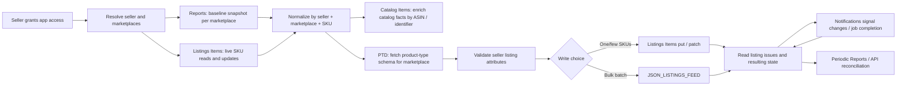

# Amazon SP-API: API directory and workflow map

> **Directory snapshot: 2026-11-05.** Amazon's official [SP-API Models directory](https://developer-docs.amazon.com/sp-api/docs/sp-api-models) listed **57 API/model-family entries** when reviewed. This is a directory-entry count, not 57 APIs needed by every seller, not a count of operations, and not a count of endpoints. The directory includes seller-only, vendor-only, special-purpose and region-scoped entries. Amazon does not publish one timeless operational total. Versions and entries change; re-count from the official directory before implementation.

This playbook currently goes deep on the **seller listing migration and synchronization path**. It does not yet contain a complete operation-by-operation dossier for all 57 directory entries. Rows below distinguish covered surfaces from adjacent APIs and unreviewed scope. Use the live reference and role mapping before enabling any operation.

## Which APIs belong in a seller listing migration?

| Surface / version | Purpose | How it connects | Coverage in this playbook |
|---|---|---|---|
| [Sellers API v1](https://developer-docs.amazon.com/sp-api/reference/sellers-v1) | Seller/account marketplace participation data. | Helps discover supported marketplaces after authorization; does not import listings. | Directory only; operation-level review pending. |
| [Listings Items API v2021-08-01](https://developer-docs.amazon.com/sp-api/reference/listings-items-v2021-08-01) | Read, search, create, update, or delete seller SKU listings. | Primary live listing surface; use for bounded reads, per-SKU writes, status and issue checks. | Core migration workflow documented below. |
| [Listings Restrictions API v2021-08-01](https://developer-docs.amazon.com/sp-api/reference/listings-restrictions-v2021-08-01) | Check whether an item can be listed in a marketplace. | Optional preflight before creating or relisting an offer. | Purpose mapped; operation details pending. |
| [Catalog Items API v2022-04-01](https://developer-docs.amazon.com/sp-api/reference/catalog-items-v2022-04-01) | Search/read Amazon catalog product facts. | Enrich a seller listing by ASIN or product identifier; not a seller listing export. | [Two-operation dossier](catalog-items.md). |
| [Product Type Definitions API v2020-09-01](https://developer-docs.amazon.com/sp-api/reference/product-type-definitions-v2020-09-01) | Return product-type schemas and requirements. | Use after category/product-type resolution, before validating listing attributes. | Workflow documented; operation details pending. |
| [Reports API v2021-06-30](https://developer-docs.amazon.com/sp-api/reference/reports-v2021-06-30) | Generate and retrieve asynchronous snapshots. | All Listings / Active Listings reports can provide a large baseline; not a live state stream. | Workflow documented in [migration guide](../workflows/active-listing-migration). |
| [Feeds API v2021-06-30](https://developer-docs.amazon.com/sp-api/reference/feeds-v2021-06-30) | Submit bulk data and retrieve processing outcomes. | Optional bulk write path using `JSON_LISTINGS_FEED`; not a listing discovery API. | Lifecycle documented in the migration guide; operation dossiers pending. |
| [Notifications API v1](https://developer-docs.amazon.com/sp-api/reference/notifications-v1) | Subscribe to supported event types through configured destinations. | Signals listing issues/status or async job completion; consumers still fetch authoritative details and reconcile. | Workflow documented; per-type support must be checked. |
| [FBA Inventory API v1](https://developer-docs.amazon.com/sp-api/reference/fba-inventory-v1) | Read FBA inventory summaries. | Separate from seller-fulfilled listing quantity and listing reports. | Purpose mapped; detailed inventory sync dossier pending. |
| [Orders API v2026-01-01](https://developer-docs.amazon.com/sp-api/reference/orders-v2026-01-01) | Search and retrieve seller orders. | Separate order-ingestion workflow; not part of the listing baseline. | See [order synchronization](../workflows/order-lifecycle). |

For new order work, review Amazon's [Orders API migration guide](https://developer-docs.amazon.com/sp-api/docs/orders-api-migration-guide) and [deprecation schedule](https://developer-docs.amazon.com/sp-api/docs/sp-api-deprecations); listed v0 order operations have a published removal date of **2027-03-27**. Do not count old and new versions as separate business capabilities when reporting operation totals.

## The APIs are connected like this

This is an engineering sequence, not a provider-mandated sequence for every account. A **seller listing** is a seller's offer and submitted attributes; a **catalog item** is shared marketplace product data; **inventory** describes quantities by fulfillment surface; a **report** is an asynchronous snapshot. Keep those records separate.

## Important constraints at a glance

- **Search is paginated but bounded.** `searchListingsItems` supports one marketplace ID per call, up to 20 results per page, and Amazon documents a 1,000-result ceiling. Follow every pagination token. For a large/full listing baseline, consider a per-marketplace listing report and reconcile with API reads. [Reference](https://developer-docs.amazon.com/sp-api/reference/searchlistingsitems)
- **“Active” must be defined.** The Listings Items status filters include `BUYABLE` (purchasable) and `DISCOVERABLE` (visible); one is not a substitute for the other. Preserve raw statuses and issues. [Reference](https://developer-docs.amazon.com/sp-api/reference/searchlistingsitems)
- **Reports are asynchronous.** `GET_MERCHANT_LISTINGS_ALL_DATA` includes all listing states; `GET_MERCHANT_LISTINGS_DATA` is the Active Listings report. Request one marketplace per report. Output is tab-delimited and has a UTF-8 BOM; locale headers may vary. [Report types](https://developer-docs.amazon.com/sp-api/docs/report-type-values-inventory)
- **Feeds are bulk writes, not exports.** Amazon documents `JSON_LISTINGS_FEED` for batch listing submissions and lists a 25,000-SKU/feed cap and five submissions per five minutes in its [Listings APIs FAQ](https://developer-docs.amazon.com/sp-api/docs/listings-apis-faq). Processing remains asynchronous; submission acceptance is not proof that every listing succeeded.
- **Notifications are signals, not a state database.** Event support, destinations, role requirements, and frequency are type-specific. SQS messages may duplicate or arrive out of order. Fetch current state and reconcile. [Notification types](https://developer-docs.amazon.com/sp-api/docs/notification-type-values)
- **Limits vary.** Operation references publish default rate/burst values, but Amazon says applied usage plans can vary by selling partner/application. Use `x-amzn-RateLimit-Limit` when present and handle `429`; do not advertise a single universal API quota. [Rate-limit guidance](https://developer-docs.amazon.com/sp-api/docs/usage-plans-and-rate-limits)
- **Timelines are not blanket SLAs.** The cited sources do not give one completion-time promise for onboarding, listing migration, feeds, reports, or notifications. Model async states, monitor jobs, and show observed progress to users.

## What “API count” means here

The **57** figure counts headings in Amazon's SP-API Models directory snapshot on 2026-11-05. That directory combines distinct versions and account eligibility groups (seller/vendor) and includes special or regional entries. It does not count operations. This playbook's scoped inventory above is a subset and is not a substitute for Amazon's current use-case directories. To count an implementation scope, record the selected API family, model version, operation names, seller/vendor eligibility, and review date. See [seller use cases](https://developer-docs.amazon.com/sp-api/docs/sp-api-seller-use-cases), [vendor use cases](https://developer-docs.amazon.com/sp-api/docs/sp-api-vendor-use-cases), and the [official models repository](https://github.com/amzn/selling-partner-api-models).

## Evidence status

**Officially documented** means the linked Amazon page or model states the fact. **Recommended implementation** means a reliability or data-model practice, not an Amazon guarantee. **Not yet reviewed** means this repository has not yet completed an operation-by-operation dossier. No guide in this repository claims production testing unless it records a specific authorized test, environment, date, and scope.
