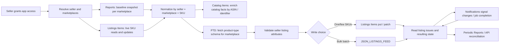

# Amazon SP-API: API directory and workflow map

> **Directory snapshot: 2026-11-06.** Amazon's official [SP-API Models directory](https://developer-docs.amazon.com/sp-api/docs/sp-api-models) lists **57 API/model-family entries** in this snapshot. This is a directory-entry count, not 57 APIs needed by every seller, not a count of operations, and not a count of endpoints. The directory includes seller-only, vendor-only, shared, special-purpose, and region-scoped entries. Versions and entries change; re-count from the official directory before implementation.

This playbook currently goes deep on the **seller listing migration and synchronization path** and begins operation-level coverage for Catalog Items, Listings Items, Orders, and Reports. The [seller-versus-vendor comparison](seller-vendor-comparison.md) classifies all 57 directory entries at the family/use-case level. It does not replace operation-level permission checks or complete the remaining API dossiers. Use the live reference and role mapping before enabling any operation.

## How Amazon's official documentation is organized

Amazon's [Welcome to SP-API Documentation](https://developer-docs.amazon.com/sp-api/docs/welcome) is a directory, not one consolidated endpoint manual. It links to the interactive [API references](https://developer-docs.amazon.com/sp-api/reference), [code recipes](https://developer-docs.amazon.com/sp-api/recipes), the [SP-API Models index](https://developer-docs.amazon.com/sp-api/docs/sp-api-models), the [deprecation schedule](https://developer-docs.amazon.com/sp-api/docs/sp-api-deprecations), release notes, FAQs, and the API health dashboard. Amazon's [official models repository](https://github.com/amzn/selling-partner-api-models) contains versioned Swagger/OpenAPI artifacts, client libraries, and JSON schemas.

For a developer portal, these sources serve different purposes:

1. Generate or verify operation names, methods, paths, request parameters, request/response schemas, and model versions against Amazon's versioned API models.
2. Use Amazon's API reference and use-case guides to explain purpose, prerequisites, role requirements, region/marketplace support, operation behavior, error cases, rate plans, and async workflow.
3. Link to official recipes for supported examples. Any additional payload examples in this project must be labeled as synthetic/illustrative, schema-checked, and tied to a precise API model version; do not imply Amazon supplied an example when it did not.
4. Link each page back to its exact Amazon API reference, model file, limits page, and testing guidance. Recheck deprecation and release notes before publishing updates.

The model files are the structured source for operation and payload shapes, but they do not replace the narrative guides: access rules, practical workflows, quotas, timing, and testing caveats may live on separate Amazon pages or vary by operation. A spec-derived reference should explicitly say when an example, limit, or workflow was not found rather than fill the gap by guesswork.

## Coverage completed so far

| Work item | Status |
|---|---|
| Amazon official Welcome page and models-repository roles in the documentation ecosystem | Reviewed; links recorded above. |
| API-family directory count | 57 headings in the official SP-API Models directory snapshot dated 2026-11-06; this is not an operation count. |
| Seller connection and authorization workflow | Documented in the [seller onboarding guide](../guides/seller-onboarding.md); official-source review only, no account test. |
| Existing seller listing migration and API relationships | Documented in the [active-listing migration workflow](../workflows/active-listing-migration.md); official-source review only, no sandbox/account test. |
| Seller-versus-vendor audience comparison | [All 57 directory entries](seller-vendor-comparison.md) classified by official directory/use-case evidence; operation-level access must still be verified. |
| Catalog Items v2022-04-01 | [Operation reference](catalog-items-reference.md) and [integration guide](catalog-items.md); two operations; documentation review only, no sandbox/account test. |
| Listings Items v2021-08-01 | [Operation dossier](listings-items.md); documentation review only, no sandbox/account test. |
| Orders v2026-01-01 | [Operation dossier](orders.md); documentation review only, no sandbox/account test. |
| Reports v2021-06-30 | [Operation dossier](reports.md); documentation review only, no sandbox/account test. |
| Orders and Listings Items code examples | Credential-safe Python request and error-handling examples; no live credentials or tests. |
| Finances API v0 | [Operation dossier](finances.md); documentation review only, no sandbox/account test. |
| Feeds API v2021-06-30 | [Operation dossier](feeds.md); documentation review only, no sandbox/account test. |
| FBA Inventory API v1 | [Operation dossier](fba-inventory.md); documentation review only, no sandbox/account test. |
| SP-API notifications | [Notification integration guide](../guides/notifications-integration.md); event delivery and app webhook boundary documented, no account test. |
| Remaining API families | Operation-by-operation documentation, payloads, roles, limits, and async behavior remain **not completed**; this remains a phased, partial API reference. |

## Which APIs belong in a seller listing migration?

| Surface / version | Purpose | How it connects | Coverage in this playbook |
|---|---|---|---|
| [Sellers API v1](https://developer-docs.amazon.com/sp-api/reference/sellers-v1) | Seller/account marketplace participation data. | Helps discover supported marketplaces after authorization; does not import listings. | Directory only; operation-level review pending. |
| [Listings Items API v2021-08-01](https://developer-docs.amazon.com/sp-api/reference/listings-items-v2021-08-01) | Read, search, create, update, or delete seller SKU listings. | Primary live listing surface; use for bounded reads, per-SKU writes, status and issue checks. | Core migration workflow documented below. |
| [Listings Restrictions API v2021-08-01](https://developer-docs.amazon.com/sp-api/reference/listings-restrictions-v2021-08-01) | Check whether an item can be listed in a marketplace. | Optional preflight before creating or relisting an offer. | Purpose mapped; operation details pending. |
| [Catalog Items API v2022-04-01](https://developer-docs.amazon.com/sp-api/reference/catalog-items-v2022-04-01) | Search/read Amazon catalog product facts. | Enrich a seller listing by ASIN or product identifier; not a seller listing export. | [Operation reference](catalog-items-reference.md); see also the [integration guide](catalog-items.md). |
| [Product Type Definitions API v2020-09-01](https://developer-docs.amazon.com/sp-api/reference/product-type-definitions-v2020-09-01) | Return product-type schemas and requirements. | Use after category/product-type resolution, before validating listing attributes. | Workflow documented; operation details pending. |
| [Reports API v2021-06-30](https://developer-docs.amazon.com/sp-api/reference/reports-v2021-06-30) | Generate and retrieve asynchronous snapshots. | All Listings / Active Listings reports can provide a large baseline; not a live state stream. | [Operation dossier](reports.md) and [migration workflow](../workflows/active-listing-migration.md). |
| [Feeds API v2021-06-30](https://developer-docs.amazon.com/sp-api/reference/feeds-v2021-06-30) | Submit bulk data and retrieve processing outcomes. | Optional bulk write path using supported feed types; not a listing discovery API. | [Operation dossier](feeds.md). |
| [Notifications API v1](https://developer-docs.amazon.com/sp-api/reference/notifications-v1) | Subscribe to supported event types through configured destinations. | Signals listing issues/status or async job completion; consumers still fetch authoritative details and reconcile. | See the [notification integration guide](../guides/notifications-integration.md); verify type support. |
| [FBA Inventory API v1](https://developer-docs.amazon.com/sp-api/reference/fba-inventory-v1) | Read FBA inventory summaries. | Separate from seller-fulfilled listing quantity and listing reports. | [Operation dossier](fba-inventory.md). |
| [Finances API v0](https://developer-docs.amazon.com/sp-api/reference/finances-v0) | Retrieve seller financial events and event groups. | Finance reconciliation is separate from vendor remittance and payout APIs. | [Operation dossier](finances.md). |
| [Orders API v2026-01-01](https://developer-docs.amazon/sp-api/reference/orders-v2026-01-01) | Search and retrieve seller orders. | Separate order-ingestion workflow; not part of the listing baseline. | [Operation dossier](orders.md) and [order synchronization](../workflows/order-lifecycle.md). |

For new order work, review Amazon's [Orders API migration guide](https://developer-docs.amazon.com/sp-api/docs/orders-api-migration-guide) and [deprecation schedule](https://developer-docs.amazon.com/sp-api/docs/sp-api-deprecations); listed v0 order operations have a published removal date of **2027-03-27**. Do not count old and new versions as separate business capabilities when reporting operation totals.

## The APIs are connected like this

This is an engineering sequence, not a provider-mandated sequence for every account. A **seller listing** is a seller's offer and submitted attributes; a **catalog item** is shared marketplace product data; **inventory** describes quantities by fulfillment surface; a **report** is an asynchronous snapshot. Keep those records separate.

## Important constraints at a glance

- **Search is paginated but bounded.** `searchListingsItems` supports one marketplace ID per call, up to 20 results per page, and Amazon documents a 1,000-result ceiling. Follow every pagination token. For a large/full listing baseline, consider a per-marketplace listing report and reconcile with API reads. [Reference](https://developer-docs.amazon.com/sp-api/reference/searchlistingsitems)
- **“Active” must be defined.** The Listings Items status filters include `BUYABLE` (purchasable) and `DISCOVERABLE` (visible); one is not a substitute for the other. Preserve raw statuses and issues. [Reference](https://developer-docs.amazon.com/sp-api/reference/searchlistingsitems)
- **Reports are asynchronous.** `GET_MERCHANT_LISTINGS_ALL_DATA` includes all listing states; `GET_MERCHANT_LISTINGS_DATA` is the Active Listings report. Request one marketplace per report. Output is tab-delimited and has a UTF-8 BOM; locale headers may vary. [Report types](https://developer-docs.amazon.com/sp-api/docs/report-type-values-inventory)
- **Feeds are bulk writes, not exports.** Amazon documents `JSON_LISTINGS_FEED` for batch listing submissions and lists a 25,000-SKU/feed cap and five submissions per five minutes in its [Listings APIs FAQ](https://developer-docs.amazon.com/sp-api/docs/listings-apis-faq). Processing remains asynchronous; submission acceptance is not proof that every listing succeeded.
- **Notifications are signals, not a state database.** Event support, destinations, role requirements, and frequency are type-specific. SQS messages may duplicate or arrive out of order. Fetch current state and reconcile. [Notification types](https://developer-docs.amazon.com/sp-api/docs/notification-type-values)
- **Limits vary.** Operation references publish default rate/burst values, but Amazon says applied usage plans can vary by selling partner/application. Use `x-amzn-RateLimit-Limit` when present and handle `429`; do not advertise a single universal API quota. [Rate-limit guidance](https://developer-docs.amazon.com/sp-api/docs/usage-plans-and-rate-limits)
- **Timelines are not blanket SLAs.** The cited sources do not give one completion-time promise for onboarding, listing migration, feeds, reports, or notifications. Model async states, monitor jobs, and show observed progress to users.

## What “API count” means here

The **57** figure counts headings in Amazon's SP-API Models directory snapshot on 2026-11-05. That directory combines distinct versions and account eligibility groups (seller/vendor) and includes special or regional entries. It does not count operations. This playbook's scoped inventory above is a subset and is not a substitute for Amazon's current use-case directories. To count an implementation scope, record the selected API family, model version, operation names, seller/vendor eligibility, and review date. See [seller use cases](https://developer-docs.amazon.com/sp-api/docs/sp-api-seller-use-cases), [vendor use cases](https://developer-docs.amazon.com/sp-api/docs/sp-api-vendor-use-cases), and the [official models repository](https://github.com/amzn/selling-partner-api-models).

## Evidence status

**Officially documented** means the linked Amazon page or model states the fact. **Recommended implementation** means a reliability or data-model practice, not an Amazon guarantee. **Not yet reviewed** means this repository has not yet completed an operation-by-operation dossier. No guide in this repository claims production testing unless it records a specific authorized test, environment, date, and scope.
