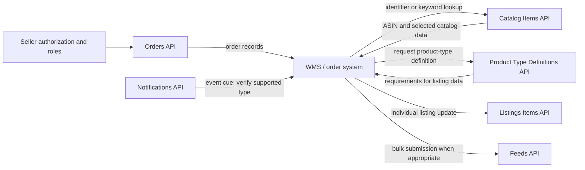

# Amazon SP-API catalog (initial scope)

This is a **curated six-family scope** for the workflows currently summarized in this repository—not a count of every API in Amazon SP-API. The number of API groups in Amazon's full catalog and operation totals for the other versioned models have **not yet been inventoried**. Catalog Items v2022-04-01 has its own dossier and model-verified count of two operations. Do not infer provider-wide totals from this page. Count them only from Amazon's current official catalog/model files and record model version, region, inclusion rules, and review date.

| API family | Version / region | Primary purpose and features | Workflow connection | Timing and limit source | Operation count status |
|---|---|---|---|---|---|
| Catalog Items API | v2022-04-01; NA, EU, FE | Read/search catalog item data by identifiers, keywords, or ASIN; summaries, attributes, identifiers, images, and related datasets. | Product matching and catalog enrichment; does not write seller listings. | [Operation reference](https://developer-docs.amazon/sp-api/docs/catalog-items-api-v2022-04-01-reference) and [usage plans](https://developer-docs.amazon/sp-api/docs/usage-plans-and-rate-limits). | 2 operations; [complete dossier](catalog-items.md) |
| Orders API | v2026-01-01 target; regional SP-API endpoints | Discover and retrieve seller orders; current field availability and permissions depend on version, role, and requested data. | Order discovery workflow; downstream internal order ingestion and reconciliation. Shipment-confirmation/write-back APIs are not covered here. | [Usage plans and rate limits](https://developer-docs.amazon/sp-api/docs/usage-plans-and-rate-limits); [Orders API guide](https://developer-docs.amazon/sp-api/docs/orders-api). Do not assume a fixed polling cadence. | Not inventoried from the current model |
| Listings Items API | v2021-08-01 | Read or update an individual seller listing; listing fields and update requirements depend on product type and marketplace. | Merchant-fulfilled listing/inventory workflow. | [Usage plans and rate limits](https://developer-docs.amazon/sp-api/docs/usage-plans-and-rate-limits); [Listings Items API](https://developer-docs.amazon/sp-api/docs/listings-items-api). | Not inventoried from the current model |
| Product Type Definitions API | v2020-09-01 | Obtain marketplace/product-type-specific requirements used to construct or validate listing data. It is a schema/definition source, not itself the listing-write workflow. | Upstream of Listings Items or a supported listings-feed submission when product definitions are needed. | [Usage plans and rate limits](https://developer-docs.amazon/sp-api/docs/usage-plans-and-rate-limits); [Product Type Definitions API](https://developer-docs.amazon/sp-api/docs/product-type-definitions-api). | Not inventoried from the current model |
| Notifications API | v1 | Subscribe to supported notification types and receive event messages through configured destinations. Event coverage, delivery behavior, and setup are type-specific. | Event-assisted order/listing updates; keep reconciliation because notifications are not the whole data record. | [Notifications use-case guide](https://developer-docs.amazon/sp-api/docs/notifications-api-v1-use-case-guide); [usage plans](https://developer-docs.amazon/sp-api/docs/usage-plans-and-rate-limits). Verify delivery/retry details per notification type. | Not inventoried from the current model |
| Feeds API | Version and region: verify current official model before implementation | Submit supported bulk data feeds and retrieve processing status/results; feed type and processing behavior are specific to the feed. | Candidate bulk listing workflow; not a substitute for individual listing operations in every use case. | [Manage product listings guide](https://developer-docs.amazon/sp-api/docs/manage-product-listings-guide); [usage plans](https://developer-docs.amazon/sp-api/docs/usage-plans-and-rate-limits). Verify feed processing windows and quota per feed. | Not inventoried from the current model |

## Cross-API workflow connections

This is a high-level integration pattern, not a provider-required sequence for every seller or workflow. The diagram does not establish shipment-confirmation, cancellation, returns, refund, or fulfillment coverage. Those require separate API/version research and explicit workflow documentation. Notifications may signal change but should not be treated as a replacement for authoritative reads and reconciliation unless Amazon documents that guarantee for the specific event.

## Count and coverage method

Before publishing exact totals:

1. Define whether “API count” means API groups, versions, operations, resources, notification types, or endpoints. Report these as separate measures.
2. Use the official [SP-API reference](https://developer-docs.amazon/sp-api/docs/welcome) and Amazon's [Selling Partner API models repository](https://github.com/amzn/selling-partner-api-models). Record the exact model paths/revisions and relevant regional scope.
3. Decide whether deprecated operations, versioned duplicates, shared schemas, and region-specific variants are included; state the rule.
4. Tally the complete provider portfolio separately from this playbook's selected groups and workflow operations. Recheck on model/changelog updates.

## Current documentation status

The Catalog Items dossier documents both operations in the current v2022-04-01 model and includes source-linked constraints, payloads, and implementation examples. For the other families, detailed operation counts, per-operation payloads, complete cross-API sequencing, and exact sourced timing/limit values remain **to be researched and verified**. The provider-wide API-group total also remains uninventoried. Until then, treat those count fields as unverified—not zero. Add one dossier per remaining API group using the reusable `marketplaces/_template/apis/api-template.md` template.
