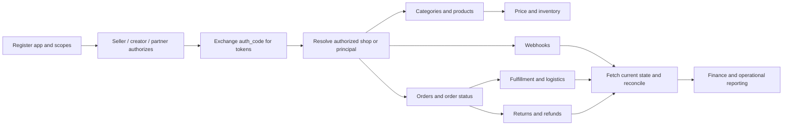

# TikTok Shop Partner API: API directory and workflow map

> **Directory snapshot: 2026-11-10.** TikTok Shop's official TTS API overview groups the platform into Product, Order, Fulfillment, Return & Refund, Logistics, Promotion, Finance, Seller, Authorization, Events, Data Reconciliation, and Supply Chain APIs. This page maps those official domains; it is not a claim that every operation is available to every app, seller, region, or authorization principal.

TikTok Shop calls this platform the **TTS API**. It exposes authorized shop data and actions for products, orders, shipments, payments, promotions, seller context, and related services. The API is versioned, scopes are endpoint-specific, and the required authorization principal may be seller, creator, partner, or another entity tag. Confirm the current version selector, entity tag, required scope, target market, and app eligibility on each live reference page before implementation.

## API family directory

| API family | What it covers | Coverage in this playbook |
|---|---|---|
| [Product API](products.md) | Categories, attributes, media, product creation/editing, product details, price and inventory surfaces. | Domain guide; operation-level links and lifecycle notes. |
| [Order API](orders.md) | Order list/detail retrieval, order identifiers, status transitions, and order webhooks. | Domain guide; synchronization workflow and status model. |
| [Fulfillment API](fulfillment.md) | Seller shipment actions, 3PL/4PL fulfillment, FBT status, and order fulfillment state. | Domain guide; implementation boundaries. |
| [Return & Refund API](returns-refunds.md) | Consumer return/refund information and seller review actions. | Domain guide; regional and after-sales caveats. |
| [Logistics API](fulfillment.md#logistics-api) | Warehouses, delivery options, shipping providers, and logistics context. | Domain guide; endpoint selection notes. |
| [Finance API](fulfillment.md#finance-api) | Payment and settlement information. | Domain guide; reconciliation boundary. |
| Promotion API | Promotions, discounts, and offers for products. | Official overview mapped; operation dossier pending. |
| Seller API | Cross-border shop status and Global Product eligibility context. | Official overview mapped; operation dossier pending. |
| [Authorization API](authorization.md) | OAuth authorization, token exchange/refresh, authorized shops, and authorization principals. | Core guide and token lifecycle. |
| [Events API](events.md) | Webhook subscription and business-event notifications. | Core webhook and reconciliation guide. |
| Data Reconciliation API | External data transfer for Quality Engine reconciliation. | Official overview mapped; operation dossier pending. |
| Supply Chain API | Certified warehouse package-fulfillment reporting. | Official overview mapped; partner-only boundary. |

## How to use this directory

The official overview is the best starting point for choosing a domain. The [developer guide](../guides/development-guide.md) covers onboarding, app registration, scopes, authorization, and the first signed call. For each operation, use the live Partner Center API reference to verify the current version, method, path, required identifiers, entity tag, access scope, request schema, response schema, and endpoint-specific errors.

The API reference is not a substitute for a reliable integration design. Keep authorization records, shop identity, products, orders, shipments, returns, and financial events as separate internal records. Webhooks are change signals; fetch authoritative state and reconcile after receiving them. Treat API acceptance as different from completed business processing.

## Core integration flow

This is an engineering sequence, not a provider-mandated sequence for every app. A seller app, creator app, partner/TAP app, cross-border app, logistics provider, and certified warehouse partner do not have the same data boundary.

## Evidence status

**Officially documented** means the linked TikTok Shop Partner Center page states the fact. **Recommended implementation** means a reliability or data-model practice, not a TikTok guarantee. **Mapped, operation dossier pending** means the official family is confirmed in the API overview but this repository has not yet reproduced every operation and schema. No page in this section claims a production API call, sandbox run, or account authorization test.

## Official entry points

- [TTS API overview](https://partner.tiktokshop.com/docv2/page/tts-api-concepts-overview)
- [TikTok Shop developer guide](https://partner.tiktokshop.com/docv2/page/656559fcf4488c02dfe8ce82)
- [API reference](https://partner.tiktokshop.com/docv2/page/create-product)
- [API versioning](https://partner.tiktokshop.com/docv2/page/api-versioning)
- [Access scope](https://partner.tiktokshop.com/docv2/page/access-scope)
- [Common errors](https://partner.tiktokshop.com/docv2/page/678e3a45786253031531b942)
